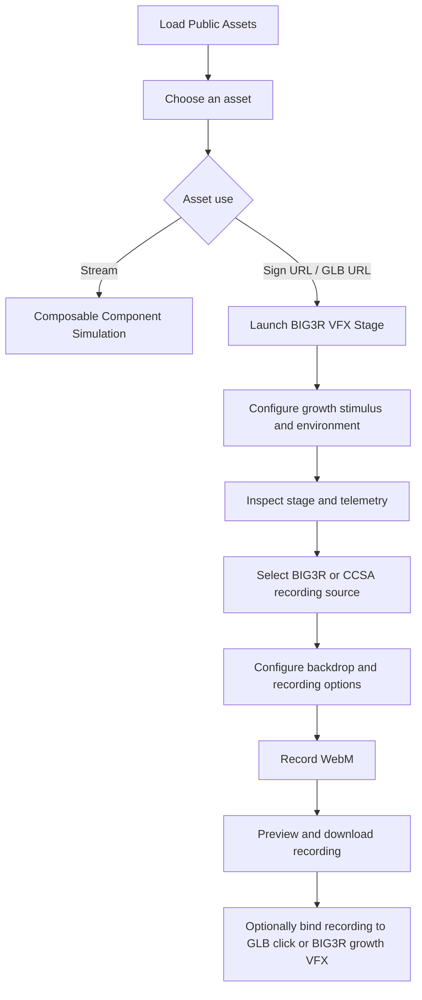

# M1AS Content Viewer

## Purpose

`m1as-content-viewer.html` is the browser-based deployment test and evaluation page for **M1AS, BIG3R, and the CCSA composition/recording workflow**.

The page brings together:
- M1AS public-asset browsing and signed-stream testing.
- Composable component rendering from a signed stream URL.
- BIG3R growth, cinema, camera, room, and spatial-progression testing.
- CCSA/BIG3R recording to WebM, including backdrop and VFX workflows.
- A browser-local team scratchpad for test notes.

This README documents the controls and structure present in the HTML. It does not describe proposed panels or features that are not present in that file.

## Page layout

The HTML presents these sections in document order:

1. **.webm VFX & CCSA Composition Recorder**
2. **BIG3R Growth, Cinema & Spatial Progression Sandbox**
3. **Team Scratchpad**
4. **Composable Component Simulation Area**
5. **M1AS Asset Browser**

The M1AS asset browser is represented by the `#loadAssets` button and `#assetList` container near the bottom of the page. The composable component area is represented by `#streamUrlInput`, `#renderComponentBtn`, and `#componentStage`.

## 1. .webm VFX & CCSA Composition Recorder

This section records either the selected live source or a procedural VFX source as WebM. It also supports loading a streamed backdrop and selecting the recording output mode.

### Backdrop and output controls

| Control | Purpose |
|---|---|
| Paste M1AS signed image, WebM, or MP4 stream URL | Supplies a backdrop stream URL. |
| Recording Output | Selects **Transparent foreground** or **Flattened backdrop + foreground**. |
| Load M1AS Stream | Loads the supplied backdrop stream. |
| Clear Backdrop | Clears the current backdrop. |

The preview area contains the recorded WebM preview and these actions:

| Button | Purpose |
|---|---|
| Download .webm | Downloads the recorded WebM. |
| Download Recording JSON | Downloads recording metadata. This control is initially disabled in the HTML. |
| Bind to Active .glb Click | Binds the recording to the active GLB click workflow. |
| Bind to BIG3R Growth VFX | Binds the recording to BIG3R growth VFX. |

### Recording source

The source selector offers:

- BIG3R Growth & Cinema Sandbox
- Live CCSA 3D Stage
- BIG3R — Procedural Tube Growth (36s)
- Procedural Alpha VFX: Growth Surge
- Procedural Alpha VFX: Colossal Burst
- Procedural Alpha VFX: Gate Shatter & Dust
- Procedural Alpha VFX: Purple Magic Smoke
- Procedural Alpha VFX: Midpoint Lightning
- Procedural Alpha VFX: 2D Metaball Fluid
- Procedural Alpha VFX: Thick Goo / Jelly Pour
- Procedural Alpha VFX: Spinning M1 Coin
- Procedural Alpha VFX: Spinning Skull

### BIG3R recording-camera controls

When the BIG3R recording controls are shown, the HTML provides:

| Control | Available settings or action |
|---|---|
| Growth Direction | North / Up, South / Down, East / Right, West / Left |
| Growth Trajectory | Legacy Cardinal (Original), Forward / Inflate → Bend North |
| Morphology | Elongated Body (Gentle Crown Compression), Compressed Crown (Stronger Terminal Compression) |
| Root Anchor X / Y | Range controls from -256 to 256 |
| Camera Angle | Top Down, Ceiling, 45° Left, 45° Right |
| Framing | Hybrid, Pullback, Locked |
| Reset Camera | Resets the camera. |
| Record Camera Motion | Starts a camera-motion take. |
| Stop Motion Take | Stops the camera-motion take; initially disabled. |
| Clear Motion | Clears the motion take. |
| Camera configuration name | Name entered before saving a camera configuration. |
| Save Camera | Saves the camera configuration. |
| Saved camera configurations | Selects a saved configuration. |
| Restore | Restores the selected configuration. |
| Delete | Deletes the selected configuration. |

The interface notes that a saved motion take replays on the next 36-second recording.

Camera interaction instructions displayed in the page:
- Drag: orbit.
- Shift + drag or right-drag: pan.
- Mouse wheel: zoom.

### Recording controls

| Control | Purpose |
|---|---|
| Fluid Viscosity | Adjusts the viscosity setting; the displayed value starts at 0.90. |
| Transparent BG (CCSA) | Toggles the transparent-background option. |
| Start Recording (.webm) | Starts recording. |
| Stop & Preview | Stops recording and previews the result. This control is initially disabled. |

The recorder status element initially reports that it is ready to record VP9 WebM.

## 2. BIG3R Growth, Cinema & Spatial Progression Sandbox

This section provides the BIG3R stage launch controls, growth stimulus testing, nested-box environment settings, CCSA room-slot painting, camera-rig selection, scene-prop spawning, and stage telemetry.

### Stage inputs

| Control | Purpose |
|---|---|
| GLB signed URL | Supplies the GLB character or scene asset URL. |
| Optional WebM VFX signed URL | Supplies an optional WebM overlay URL. |
| Launch VFX Stage | Launches the VFX stage. |

The page also instructs users that a GLB asset card can provide a **VFX Stage** action.

### Growth mode and stimulus

**Mode** options:

- Click / Tap Impulse
- Rapid Mash Cascade
- Hold-to-Charge Surge
- Chaos Factor (Delayed Colossal)

**Stimulus** options:

- Consumption (Proportional Height)
- Exercise (Upper Body → Golden Ratio Buffer)
- Buff / Growth Tool (High Pressure)
- Environmental Surge

| Button | Purpose |
|---|---|
| Queue Stimulus (Space) | Queues a growth stimulus. The page also identifies Space as its keyboard shortcut. |
| Hold Charge | Activates the hold-to-charge control. |
| Colossal Chaos | Activates the colossal-chaos control. |
| Reset | Resets the growth test. |

### Nested Box Stage and camera toggle

The **Nested Box Stage** selector offers:

1. Broken Jar (1.6m Ceiling)
2. Sewer Pipes (2.4m Ceiling)
3. Lab Growth Tank (3.2m Ceiling)
4. Lab Viewing Room / Vent (5.0m Ceiling)
5. Escape: Street / Cars & Houses (9.5m)

The **Ceiling** range control spans 1.5m to 12.0m and displays its current value.

The **Cinematic Low-Angle & FOV Kick** checkbox is enabled by default.

### CCSA room-slot painting

The room-slot selector contains:

| Slot | Face |
|---|---|
| bg | Backdrop |
| 0 | +X Right Wall |
| 1 | -X Left Wall |
| 2 | +Y Ceiling |
| 3 | -Y Floor |
| 4 | +Z Front Wall |
| 5 | -Z Back Wall |

The adjacent asset-type selector offers:

- Color Hex
- Image (.png/.webp/.jpg)
- Video (.webm/.mp4)
- Audio Visualizer (.mp3)
- SVG
- JSON / Text

Enter a color value or asset URL in the value field, then use **Paint Slot**.

Additional controls:

| Control | Purpose |
|---|---|
| Double-Sided Room | Toggles the double-sided-room option. |
| Export Preset | Exports a room preset. |
| Import Preset | Opens the room-preset import workflow. |

### Camera rig

The camera-rig selector offers:

1. FreeExplore + HeightReticle
2. Obs1 (Scale Observer)
3. Obs2 (4-Face TV Inspect)
4. FirstPerson (Eye Creep + Shake)
5. Worms / BirdsEye + DynamicNearClip

| Button | Purpose |
|---|---|
| Spawn 4-Face TV | Spawns the four-face TV inspection object. |

### Level manifest

| Control | Purpose |
|---|---|
| Load Level Manifest (.json) | Opens the level-manifest import workflow. |

### Scene props

Enter a signed GLB URL, select a role, set its height, and use **Spawn Prop**.

Available roles:

- Consumable (Breaks at 65% height)
- Clothes / Growth Suit (85%)
- Growth Tank / Jar (102%)
- Growth Gate / Ceiling Vent (102%)
- Scale Reference (T-Pose / Car / House)

The height input starts at 0.6m and has a displayed range of 0.1m to 15.0m.

| Button | Purpose |
|---|---|
| + Spawn Prop | Spawns the selected scene prop. |
| Respawn Broken | Respawns broken props. |

### BIG3R rendering and telemetry

The rendering area contains:

- **Height Reticle** (`#vfxHeightReticle`), initially hidden.
- **Streaming HUD** (`#vfxStreamingHud`).
- **TTL status** (`#ttlStatus`).
- **Growth telemetry badge** (`#vfxTelemetryBadge`), initially showing Tier 1, Broken Jar, scale 1.00x, posture STAND, and Golden Buffer 0.00.
- **BIG3R stage container** (`#vfxStageContainer`), initially showing an idle-stage prompt.

## 3. Team Scratchpad

The Team Scratchpad is a notes area for stage notes, scale adjustments, and VFX timing issues.

| Button | Purpose |
|---|---|
| Copy | Copies the textarea contents to the clipboard. |
| Clear | Prompts for confirmation, then clears the notes and their local-storage entry. |
| Save | Saves the notes to browser local storage. |

The textarea also writes its contents to local storage as the user types. The page restores the saved notes from the `m1as_team_notes` local-storage key when the page loads.

## 4. Composable Component Simulation Area

This section tests rendering a component from an M1AS signed stream URL.

| Element | Purpose |
|---|---|
| Signed stream URL input | Accepts an M1AS signed stream URL. |
| Render Component | Renders the component into the simulation stage. |
| Component stage | Displays the rendered component or its empty-state prompt. |

The page instructions also describe two asset-card actions:
- **Stream**: renders an asset in the component area.
- **Sign URL**: copies a signed stream token for use as a 3D cube face.

## 5. M1AS Asset Browser

The bottom of the HTML contains:

- **Load Public Assets** (`#loadAssets`).
- **Asset list** (`#assetList`).

The asset list is where the viewer displays public asset records. The page instructions describe using the asset-card **Stream** and **Sign URL** actions.

## End-to-end evaluation flow

The page's controls support this practical test sequence:

The Team Scratchpad can be used alongside these tests to retain notes in the browser.

## Source file

The page documented here is:

- [`dev/m1as-content-viewer.html`](./m1as-content-viewer.html)

The HTML references its viewer stylesheet and JavaScript module. This README describes the controls and structure declared in the HTML; it does not claim that every control or workflow has been independently runtime-tested.
