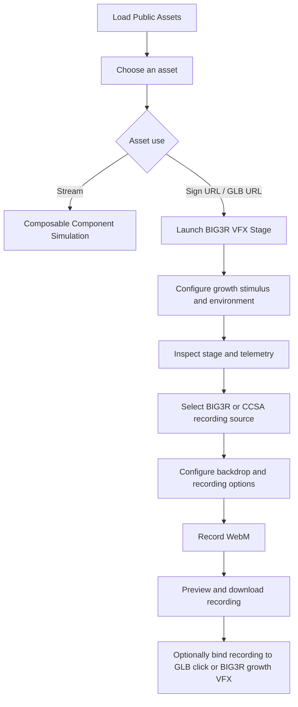
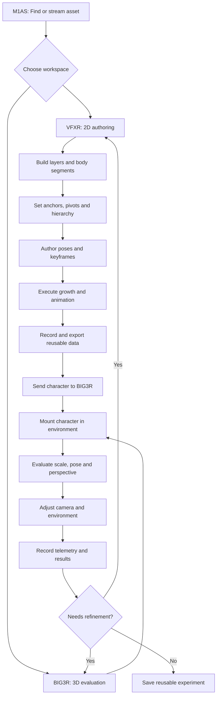
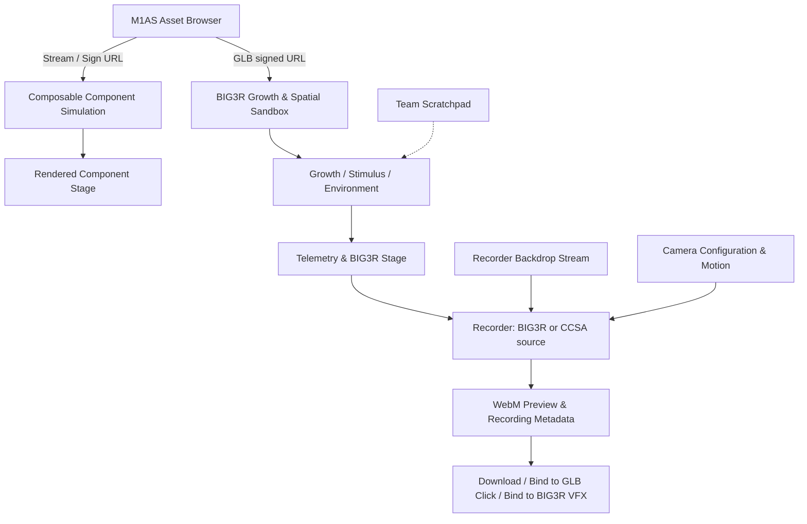

# M1AS Content Viewer

## Purpose

`m1as-content-viewer.html` is the browser-based deployment test and evaluation page for **M1AS, BIG3R, and the CCSA composition/recording workflow**.

The page brings together:
- M1AS public-asset browsing and signed-stream testing.
- Composable component rendering from a signed stream URL.
- BIG3R growth, cinema, camera, room, and spatial-progression testing.
- CCSA/BIG3R recording to WebM, including backdrop and VFX workflows.
- A browser-local team scratchpad for test notes.

This README documents the controls and structure present in the HTML. It does not describe proposed panels or features that are not present in that file.

## Page layout

The HTML presents these sections in document order:

1. **.webm VFX & CCSA Composition Recorder**
2. **BIG3R Growth, Cinema & Spatial Progression Sandbox**
3. **Team Scratchpad**
4. **Composable Component Simulation Area**
5. **M1AS Asset Browser**

The M1AS asset browser is represented by the `#loadAssets` button and `#assetList` container near the bottom of the page. The composable component area is represented by `#streamUrlInput`, `#renderComponentBtn`, and `#componentStage`.

## 1. .webm VFX & CCSA Composition Recorder

This section records either the selected live source or a procedural VFX source as WebM. It also supports loading a streamed backdrop and selecting the recording output mode.

### Backdrop and output controls

| Control | Purpose |
|---|---|
| Paste M1AS signed image, WebM, or MP4 stream URL | Supplies a backdrop stream URL. |
| Recording Output | Selects **Transparent foreground** or **Flattened backdrop + foreground**. |
| Load M1AS Stream | Loads the supplied backdrop stream. |
| Clear Backdrop | Clears the current backdrop. |

The preview area contains the recorded WebM preview and these actions:

| Button | Purpose |
|---|---|
| Download .webm | Downloads the recorded WebM. |
| Download Recording JSON | Downloads recording metadata. This control is initially disabled in the HTML. |
| Bind to Active .glb Click | Binds the recording to the active GLB click workflow. |
| Bind to BIG3R Growth VFX | Binds the recording to BIG3R growth VFX. |

### Recording source

The source selector offers:

- BIG3R Growth & Cinema Sandbox
- Live CCSA 3D Stage
- BIG3R — Procedural Tube Growth (36s)
- Procedural Alpha VFX: Growth Surge
- Procedural Alpha VFX: Colossal Burst
- Procedural Alpha VFX: Gate Shatter & Dust
- Procedural Alpha VFX: Purple Magic Smoke
- Procedural Alpha VFX: Midpoint Lightning
- Procedural Alpha VFX: 2D Metaball Fluid
- Procedural Alpha VFX: Thick Goo / Jelly Pour
- Procedural Alpha VFX: Spinning M1 Coin
- Procedural Alpha VFX: Spinning Skull

### BIG3R recording-camera controls

When the BIG3R recording controls are shown, the HTML provides:

| Control | Available settings or action |
|---|---|
| Growth Direction | North / Up, South / Down, East / Right, West / Left |
| Growth Trajectory | Legacy Cardinal (Original), Forward / Inflate → Bend North |
| Morphology | Elongated Body (Gentle Crown Compression), Compressed Crown (Stronger Terminal Compression) |
| Root Anchor X / Y | Range controls from -256 to 256 |
| Camera Angle | Top Down, Ceiling, 45° Left, 45° Right |
| Framing | Hybrid, Pullback, Locked |
| Reset Camera | Resets the camera. |
| Record Camera Motion | Starts a camera-motion take. |
| Stop Motion Take | Stops the camera-motion take; initially disabled. |
| Clear Motion | Clears the motion take. |
| Camera configuration name | Name entered before saving a camera configuration. |
| Save Camera | Saves the camera configuration. |
| Saved camera configurations | Selects a saved configuration. |
| Restore | Restores the selected configuration. |
| Delete | Deletes the selected configuration. |

The interface notes that a saved motion take replays on the next 36-second recording.

Camera interaction instructions displayed in the page:
- Drag: orbit.
- Shift + drag or right-drag: pan.
- Mouse wheel: zoom.

### Recording controls

| Control | Purpose |
|---|---|
| Fluid Viscosity | Adjusts the viscosity setting; the displayed value starts at 0.90. |
| Transparent BG (CCSA) | Toggles the transparent-background option. |
| Start Recording (.webm) | Starts recording. |
| Stop & Preview | Stops recording and previews the result. This control is initially disabled. |

The recorder status element initially reports that it is ready to record VP9 WebM.

## 2. BIG3R Growth, Cinema & Spatial Progression Sandbox

This section provides the BIG3R stage launch controls, growth stimulus testing, nested-box environment settings, CCSA room-slot painting, camera-rig selection, scene-prop spawning, and stage telemetry.

### Stage inputs

| Control | Purpose |
|---|---|
| GLB signed URL | Supplies the GLB character or scene asset URL. |
| Optional WebM VFX signed URL | Supplies an optional WebM overlay URL. |
| Launch VFX Stage | Launches the VFX stage. |

The page also instructs users that a GLB asset card can provide a **VFX Stage** action.

### Growth mode and stimulus

**Mode** options:

- Click / Tap Impulse
- Rapid Mash Cascade
- Hold-to-Charge Surge
- Chaos Factor (Delayed Colossal)

**Stimulus** options:

- Consumption (Proportional Height)
- Exercise (Upper Body → Golden Ratio Buffer)
- Buff / Growth Tool (High Pressure)
- Environmental Surge

| Button | Purpose |
|---|---|
| Queue Stimulus (Space) | Queues a growth stimulus. The page also identifies Space as its keyboard shortcut. |
| Hold Charge | Activates the hold-to-charge control. |
| Colossal Chaos | Activates the colossal-chaos control. |
| Reset | Resets the growth test. |

### Nested Box Stage and camera toggle

The **Nested Box Stage** selector offers:

1. Broken Jar (1.6m Ceiling)
2. Sewer Pipes (2.4m Ceiling)
3. Lab Growth Tank (3.2m Ceiling)
4. Lab Viewing Room / Vent (5.0m Ceiling)
5. Escape: Street / Cars & Houses (9.5m)

The **Ceiling** range control spans 1.5m to 12.0m and displays its current value.

The **Cinematic Low-Angle & FOV Kick** checkbox is enabled by default.

### CCSA room-slot painting

The room-slot selector contains:

| Slot | Face |
|---|---|
| bg | Backdrop |
| 0 | +X Right Wall |
| 1 | -X Left Wall |
| 2 | +Y Ceiling |
| 3 | -Y Floor |
| 4 | +Z Front Wall |
| 5 | -Z Back Wall |

The adjacent asset-type selector offers:

- Color Hex
- Image (.png/.webp/.jpg)
- Video (.webm/.mp4)
- Audio Visualizer (.mp3)
- SVG
- JSON / Text

Enter a color value or asset URL in the value field, then use **Paint Slot**.

Additional controls:

| Control | Purpose |
|---|---|
| Double-Sided Room | Toggles the double-sided-room option. |
| Export Preset | Exports a room preset. |
| Import Preset | Opens the room-preset import workflow. |

### Camera rig

The camera-rig selector offers:

1. FreeExplore + HeightReticle
2. Obs1 (Scale Observer)
3. Obs2 (4-Face TV Inspect)
4. FirstPerson (Eye Creep + Shake)
5. Worms / BirdsEye + DynamicNearClip

| Button | Purpose |
|---|---|
| Spawn 4-Face TV | Spawns the four-face TV inspection object. |

### Level manifest

| Control | Purpose |
|---|---|
| Load Level Manifest (.json) | Opens the level-manifest import workflow. |

### Scene props

Enter a signed GLB URL, select a role, set its height, and use **Spawn Prop**.

Available roles:

- Consumable (Breaks at 65% height)
- Clothes / Growth Suit (85%)
- Growth Tank / Jar (102%)
- Growth Gate / Ceiling Vent (102%)
- Scale Reference (T-Pose / Car / House)

The height input starts at 0.6m and has a displayed range of 0.1m to 15.0m.

| Button | Purpose |
|---|---|
| + Spawn Prop | Spawns the selected scene prop. |
| Respawn Broken | Respawns broken props. |

### BIG3R rendering and telemetry

The rendering area contains:

- **Height Reticle** (`#vfxHeightReticle`), initially hidden.
- **Streaming HUD** (`#vfxStreamingHud`).
- **TTL status** (`#ttlStatus`).
- **Growth telemetry badge** (`#vfxTelemetryBadge`), initially showing Tier 1, Broken Jar, scale 1.00x, posture STAND, and Golden Buffer 0.00.
- **BIG3R stage container** (`#vfxStageContainer`), initially showing an idle-stage prompt.

## 3. Team Scratchpad

The Team Scratchpad is a notes area for stage notes, scale adjustments, and VFX timing issues.

| Button | Purpose |
|---|---|
| Copy | Copies the textarea contents to the clipboard. |
| Clear | Prompts for confirmation, then clears the notes and their local-storage entry. |
| Save | Saves the notes to browser local storage. |

The textarea also writes its contents to local storage as the user types. The page restores the saved notes from the `m1as_team_notes` local-storage key when the page loads.

## 4. Composable Component Simulation Area

This section tests rendering a component from an M1AS signed stream URL.

| Element | Purpose |
|---|---|
| Signed stream URL input | Accepts an M1AS signed stream URL. |
| Render Component | Renders the component into the simulation stage. |
| Component stage | Displays the rendered component or its empty-state prompt. |

The page instructions also describe two asset-card actions:
- **Stream**: renders an asset in the component area.
- **Sign URL**: copies a signed stream token for use as a 3D cube face.

## 5. M1AS Asset Browser

The bottom of the HTML contains:

- **Load Public Assets** (`#loadAssets`).
- **Asset list** (`#assetList`).

The asset list is where the viewer displays public asset records. The page instructions describe using the asset-card **Stream** and **Sign URL** actions.

## End-to-end evaluation flow

The page's controls support this practical test sequence:

The Team Scratchpad can be used alongside these tests to retain notes in the browser.

## Source file

The page documented here is:

- [`dev/m1as-content-viewer.html`](./m1as-content-viewer.html)

The HTML references its viewer stylesheet and JavaScript module. This README describes the controls and structure declared in the HTML; it does not claim that every control or workflow has been independently runtime-tested.
-----------------------------------

1. Executive vision
The goal is to create a browser-based creative and technical workbench where a developer can rapidly assemble, animate, grow, inspect, and evaluate characters and environments without constantly switching tools or rebuilding assets.

The central idea is one connected prototyping environment, with distinct specialist workspaces sharing compatible assets, character data, growth logic, timing, and evaluation results.

The system should support an organic development process:
- Start with efficient 2D assets and experiments.
- Develop character structure, animation, growth, and posture.
- Bridge 2D characters into 2.5D through depth, volume, planes, and camera relationships.
- Evaluate characters in BIG3R's 3D environments.
- Use the shared growth and character systems to maintain consistency across representations.
- Capture, compare, record, and export experiments.
The browser is not merely an asset viewer. It is intended to become a rapid prototyping and evaluation studio.

Example: A character growing from 2D into 2.5D
1. Create the 2D character
   
   Import a sprite or assemble a vector character using separate head, torso, arms and legs.
2. Establish character structure
   
   Set anchors, pivots, parent relationships and independent segment transforms.
3. Author movement and posture
   
   Create standing, hunching, crawling and other pose transitions.
4. Run real growth experiments
   
   Apply the growth engine to the character. Distinguish actual character growth from image enlargement and camera zoom.
5. Bridge into 2.5D
   
   Introduce depth planes, volumetric representation, camera relationships and shared character semantics.
6. Evaluate in BIG3R
   
   Mount the character in an environment and evaluate spatial scale, framing, pose and environmental relationships.
7. Capture and compare
   
   Record the experiment, telemetry, camera state and reproducible configuration.
6. The 2D / 2.5D / 3D bridge
One of the most important architectural concepts is that the character should not become three unrelated assets simply because the representation changes.

BIG3R is where a character is evaluated in relation to a real environment.
Button / control	Function
Mount Character	Load a character model into the stage.
Add Prop	Add a spatial object to the scene.
Paint Slot	Apply an asset, image or material to a selected room face.
Image Rotation	Rotate the image on the selected wall without rotating the wall or camera.
Double-Sided Room	Control room-face visibility from both sides.
Box Preset	Select a predefined environment size.
Ceiling Height	Change the room ceiling.
Camera Rig	Select a camera perspective.
Orbit / Inspect	Inspect the character and environment spatially.
Pulse	Trigger a growth stimulus.
Hold Charge	Apply sustained growth input.
Colossal Chaos	Trigger the delayed colossal-growth experiment.
Reset Growth	Return the growth system to its starting state.
Export Preset	Save the stage and its configuration.
Import Preset	Restore a saved stage.

The camera is part of the scale-perception system. It is not simply a viewing accessory: character scale, environment scale, camera perspective and observer position all influence the perceived result.
D. CCSA / Recording and composition
Button	Function
Add Composition Layer	Add a visual or media layer.
Set Backdrop	Set the scene background.
Layer Order	Change foreground/background ordering.
Play Composition	Preview synchronized layers.
Record	Capture the composition.
Stop	End the capture.
Export Composite	Export the combined recording.
Export Layers	Export individual layers where supported.
Save Project	Preserve the configuration for later reproduction.

VFXR should retain its composition and layering strengths. Recording should ultimately work consistently across the authoring and evaluation workflows rather than requiring duplicated recording implementations.
5. Core workflow logic
The intended process is an iterative pipeline, not a one-way production chain.

VFXR should be a genuine 2D production and experimentation environment, not a photo viewer with a growth slider.
Button / control	Function
Add Layer	Add a background, character component, effect or overlay.
Add Body Segment	Create or import a separate torso, head or limb component.
Select / Move	Select and reposition a layer or segment.
Set Anchor	Define a pivot or attachment point.
Parent / Unparent	Establish or remove segment relationships.
Flip X / Flip Y	Correct sprite orientation.
Rotate	Adjust the selected component's orientation.
Pose	Define a character posture.
Add Keyframe	Save the current pose or transform at a point in time.
Play / Pause	Run or stop the authored sequence.
Step	Advance the animation by a controlled increment.
Grow	Execute actual growth logic, not simply zoom the image.
Reset	Restore the experiment's starting state.
Record	Capture the experiment.
Export Sequence	Export reusable animation and pose data.
Send to BIG3R	Evaluate the resulting character in a spatial environment.

Important distinction: Visual scaling, anatomical growth, camera zoom and environmental perspective are four separate things. The interface should expose them separately.
C. BIG3R — 3D Sandbox and character evaluation

This is a conceptual page arrangement, not a claim that every panel or button already exists in the current build.
Why this layout matters
- Left panel: Find, select and stream assets without leaving the workspace.
- Center: The actual subject and environment remain visible while editing.
- Right panel: Edit the selected subject, component, camera or environment.
- Timeline: Control animation, growth, pose and synchronized events.
- Bottom telemetry: See what the system is actually doing rather than relying on visual assumptions.
4. Workspace breakdown and button legend
The top-level navigation should keep the specialist workflows separate while allowing assets and experiments to move between them.
A. M1AS — Asset browser
Button	Function
Load Assets	Retrieve available project assets.
Refresh	Refresh the asset list and metadata.
Search	Find an asset by name, type or tag.
Preview	Inspect an asset before use.
Sign URL	Obtain an authenticated, usable asset stream.
Copy Stream	Copy a signed asset URL for another workflow.
Send to VFXR	Open an asset in the 2D authoring workspace.
Send to BIG3R	Open an asset for spatial evaluation.

The same asset should not need to be uploaded or implemented again just because it is used in another workspace.
B. VFXR — 2D Growth & Pose Authoring

Responsibility boundaries
System	Owns
M1AS	Asset access and streaming
VFXR	2D asset creation, animation and composition
BIG3R	Environment, 3D evaluation and presentation
Shared systems	Character identity, growth, scale, posture and time
CCSA / Recorder	Composition and capture

These are connected responsibilities, not competing implementations of the same workflow.
3. Proposed browser interface
The interface should feel like a creative production studio combined with a technical evaluation laboratory.

The shared character representation should ultimately preserve:
- Character identity.
- Actual scale and growth state.
- Body proportions and segment relationships.
- Skeleton and posture semantics.
- Anchor and pivot relationships.
- Simulation time and animation state.
A useful conceptual model is the character's volume: a 2D character can begin as a flat representation, gain a volumetric interpretation, and eventually become a fully articulated 3D character.

This allows 2D to remain a productive experimental foundation rather than a disposable prototype.

7. Growth and world-building logic
Another important idea is to evaluate growth from both sides of the character/environment relationship.

Traditional growth perspective 
Character ->
Increases in scale
Environment ->
Reference stays fixed

Reverse world-building perspective 
Character ->
Maintains visual reference 
Environment ->
Shrinks relative to character

The reverse approach could help with very large growth ranges, perspective management, clipping mitigation and cinematic effects. It is a design exploration, not a replacement for the actual growth engine.
1. Design principles and acceptance criteria
The workbench should be judged by whether it allows a developer to perform meaningful experiments, not simply whether controls appear on screen.
Principle	Required behavior
Asset continuity	M1AS streams work across VFXR and BIG3R.
Image correctness	Orientation and rotation are visible and controllable.
Real growth	Growth changes the character, not just its displayed size.
Meaningful time	Advancing time executes the intended experiment events.
Character structure	At least two independently controllable body segments for initial 2D testing.
Functional poses	Pose transitions can be played, inspected and evaluated.
Layering	Backgrounds, character parts and effects compose correctly.
Camera integrity	Camera movement and character growth remain distinguishable.
Reproducibility	Experiments preserve settings, inputs, timing and results.
Cross-dimensional continuity	2D, 2.5D and 3D retain shared character semantics.

1. Delivery boundaries and development priorities
The concept should not be mistaken for a declaration that all of these capabilities already exist.
Workstream	Direction
VFXR foundation	First: functional 2D authoring, orientation, anchors, growth, poses, playback and composition.
Golden Boy audit	Second: preserve and verify the original growth prototype and establish growth-engine parity.
BIG3R integration	Third: connect the validated character and growth systems to spatial evaluation.
2.5D bridge	Later: shared volume, depth, skeleton, camera and composition.
Advanced world-building	Later: reverse perspective growth, colossal environments and extended camera effects.

The advanced concepts remain part of the larger vision, but should not be silently promoted into immediate implementation milestones.

10. Legend: how to read the diagrams
Symbol / term	Meaning
M1AS	Asset discovery, access and streaming
VFXR	2D creation, animation and composition
BIG3R	3D environment and character evaluation
CCSA	Composition and presentation
Shared systems	Character, growth, scale, posture and time
Arrow	Data or workflow transfer
Decision diamond	User or system decision
Timeline	Synchronized animation and experiment events
Inspector	Settings for the currently selected object
Telemetry	Measured system state and experiment results
Anchor / pivot	Reference point for positioning or articulation
Preset	Reproducible configuration of a stage or experiment

Actual page layout
Page heading

13163R Streaming Test BIG3R + M1AS

A. .webm VFX & CCSA Composition Recorder
- Stream backdrop input and output-mode selector
- Load / clear backdrop
- Recorded WebM preview and download actions
- Recording source selector
- BIG3R recording camera and motion controls
- Viscosity and transparent-background controls
- Start / stop recording

B. BIG3R Growth, Cinema & Spatial Progression Sandbox
- GLB and optional WebM URL inputs
- Launch VFX Stage
- Growth mode and stimulus selectors
- Growth stimulus actions
- Nested box stage and ceiling controls
- CCSA room-slot painting controls
- Camera rig and scene prop controls
- Telemetry and BIG3R rendering stage

C. Team Scratchpad
- Persistent team notes
- Copy, clear and save controls

D. Composable Component Simulation Area
- Signed stream URL input
- Render Component action
- Component rendering stage

This is the actual structural order in the HTML, not a proposed redesign.
2. Actual button and control legend
A. Recorder
Actual control	Purpose indicated by the interface
Load M1AS Stream	Load signed image, WebM or MP4 backdrop
Clear Backdrop	Clear the current backdrop
Download .webm	Download recorded video
Download Recording JSON	Download recording metadata
Bind to Active .glb Click	Bind recording to active GLB click
Bind to BIG3R Growth VFX	Bind recording to BIG3R growth VFX
Source selector	Choose BIG3R, CCSA or listed procedural source
Reset Camera	Reset recording camera
Record Camera Motion	Record camera movement
Stop Motion Take	Stop camera motion recording
Clear Motion	Clear recorded camera motion
Save Camera	Save camera configuration
Restore	Restore selected saved configuration
Delete	Delete selected saved configuration
Start Recording (.webm)	Start recording
Stop & Preview	Stop and preview recording

Other actual controls include Recording Output, Growth Direction, Growth Trajectory, Morphology, Root Anchor X/Y, Camera Angle, Framing, Fluid Viscosity and Transparent BG.
B. BIG3R Growth, Cinema & Spatial Progression Sandbox
Actual control	Purpose indicated by the interface
Launch VFX Stage	Launch the VFX stage using the supplied GLB URL
Queue Stimulus (Space)	Queue a growth stimulus
Hold Charge	Hold-to-charge growth
Colossal Chaos	Trigger the chaos growth mode
Reset	Reset the growth test
Paint Slot	Apply the selected room-slot content
Export Preset	Export the room preset
Import Preset	Import a room preset
Spawn 4-Face TV	Spawn the four-face TV
Load Level Manifest (.json)	Load a level manifest
+ Spawn Prop	Spawn the selected scene prop
Respawn Broken	Respawn broken props

Other actual controls:
- Mode: Click / Tap Impulse, Rapid Mash Cascade, Hold-to-Charge Surge, Chaos Factor.
- Stimulus: Consumption, Exercise, Buff, Environmental.
- Nested Box Stage: Broken Jar, Sewer Pipes, Lab Growth Tank, Lab Viewing Room / Vent, Street / Cars & Houses.
- Ceiling slider.
- Cinematic Low-Angle & FOV Kick toggle.
- CCSA Room Slot: bg, Face 0 through Face 5.
- Asset Type: Color Hex, Image, Video, Audio Visualizer, SVG, JSON / Text.
- Double-Sided Room toggle.
- Camera Rig: five listed configurations.
- Prop Role: Consumable, Wearable, Container, Growth Gate, Reference.
- Prop Height input.
C. Team Scratchpad
Button	Actual action
Copy	Copy notes to clipboard
Clear	Clear notes after confirmation
Save	Save notes to local storage

The notes also save through the textarea's input handler.
D. Composable Component Simulation Area
Button	Actual action
Render Component	Render the supplied signed asset target
Load Public Assets	Load public assets into the asset browser

The section also instructs the user to use Stream on an asset card to render it below, or Sign URL to copy a signed stream token for a 3D cube face. Those are asset-card actions, not buttons declared directly in this section's HTML.

Executive conclusion
The defining vision is a unified browser-based prototyping studio built around reusable character assets and shared behavioral systems.

M1AS supplies the assets. VFXR creates and experiments with 2D characters. BIG3R evaluates those characters in spatial environments. Shared systems preserve growth, scale, pose and time. CCSA and recording capture the results.

The most important architectural decision is to preserve the distinction between authoring, simulation, presentation and evaluation while making movement between them seamless.

That is what turns a collection of browser tools into a genuine rapid-prototyping environment.